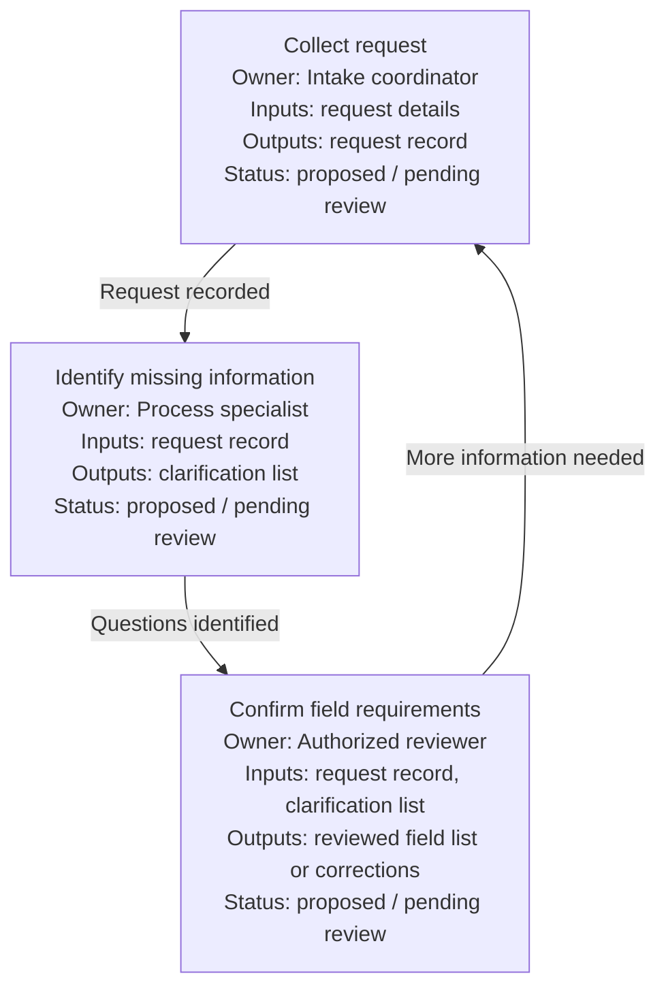

# ElicitMesh

[English](README.md) | [繁體中文](README.zh-TW.md)

**Turn an idea into a reviewable workflow diagram—with clear inputs and outputs at every node.**

ElicitMesh helps collaborators clarify a process before building it. It draws the workflow, identifies who owns each step, and makes unknown requirements visible for expert review. The diagram is the deliverable; ElicitMesh does not generate the final legal document, scope document, or other domain output described by the process.

Use it when an idea is still vague, different roles understand the process differently, or you need to agree on what information passes between steps before implementation.

[Claude Code](#install-in-claude-code) · [Codex](#install-in-codex) · [Claude.ai / ZIP](#claudeai-and-portable-skills) · [First workflow](#try-your-first-workflow)

## Three focused stages

| Skill | Use it to | Main output |
| --- | --- | --- |
| `em-brainstorm` | Clarify the goal, participants, scope, sources, and unknowns | Brief and open questions |
| `em-diagram` | Draw the process, decisions, and handoffs with explicit node I/O | Annotated diagram and I/O contracts |
| `em-review` | Find gaps, collect real expert corrections, and revise the specification | Revised diagram and review log |

Use `elicit-mesh` when you want guidance on where to start or help through the full flow. It remains the main entry point alongside the three focused skills.

Start at any stage. Existing notes, diagrams, and contracts are welcome; you do not need to repeat brainstorming.

Every diagram node shows **action, owner, inputs, outputs, and approval status**. Detailed types, required/unknown flags, expected output formats, and reviewers live in the accompanying contracts. Branches show their conditions, including missing-information paths.

## What you get

For an idea such as “help our team agree on the intake process,” the output can look like this:



This is an illustrative specification, not a record of completed work or approval. Roles and requirements are proposals to confirm. The accompanying I/O table explains each input field and expected output format; open questions identify who can resolve missing details.

## Install in Claude Code

Run inside Claude Code:

```text
/plugin marketplace add martin3252/ElicitMesh
/plugin install elicit-mesh@elicitmesh
```

Start a new session. Ask to use ElicitMesh, or invoke:

```text
/elicit-mesh:em-brainstorm We need to clarify how our intake process works.
/elicit-mesh:em-diagram Turn our notes into a diagram with I/O at every node.
/elicit-mesh:em-review Check this diagram for missing fields and unclear handoffs.
```

The existing `/elicit-mesh:elicit-mesh` entry point remains available. To update, run `/plugin marketplace update elicitmesh` then `/plugin update elicit-mesh@elicitmesh`.

## Install in Codex

Run in your terminal with a Codex CLI supporting plugins:

```sh
codex plugin marketplace add martin3252/ElicitMesh
codex plugin add elicit-mesh@elicitmesh
```

Start a new session and select a skill, ask to use ElicitMesh, or mention `$elicit-mesh:em-brainstorm`, `$elicit-mesh:em-diagram`, or `$elicit-mesh:em-review`. The umbrella skill is `$elicit-mesh:elicit-mesh`.

To update an existing Codex installation:

```sh
codex plugin marketplace upgrade elicitmesh
codex plugin add elicit-mesh@elicitmesh
```

Start a new session after updating.

See the official [Codex skills](https://developers.openai.com/codex/skills) and [plugin documentation](https://developers.openai.com/codex/plugins/build). For versions without plugins, extract a skill ZIP into `~/.agents/skills/` or your project's `.agents/skills/`; standalone skills use names such as `$em-diagram`. Choose one installation method to avoid duplicate entries.

## Claude.ai and portable skills

Download [skill.zip](https://github.com/martin3252/ElicitMesh/raw/refs/heads/main/dist/skill.zip) for the full guided workflow, or install individual stages:

- [em-brainstorm.zip](https://github.com/martin3252/ElicitMesh/raw/refs/heads/main/dist/em-brainstorm.zip)
- [em-diagram.zip](https://github.com/martin3252/ElicitMesh/raw/refs/heads/main/dist/em-diagram.zip)
- [em-review.zip](https://github.com/martin3252/ElicitMesh/raw/refs/heads/main/dist/em-review.zip)

In Claude.ai, upload the chosen ZIP under **Settings → Capabilities → Skills** and enable it. Plan, code execution/file creation, and workspace settings affect availability; see [Anthropic's current instructions](https://support.claude.com/en/articles/12512180-using-skills-in-claude). Re-upload a newer ZIP to update. Claude.ai upload is not verified by the CLI installation checks.

Each ZIP is self-contained with instructions, shared references, examples, renderer, and validator. Other compatible agents can use its extracted skill directory. English and Traditional Chinese are supported; YAML keys and IDs stay in English.

## Try your first workflow

After installing, use these prompts in your agent conversation. Each stage can also be used on its own.

### 1. Explore the idea

```text
Use em-brainstorm. I am a software engineer working with a lawyer.
We want to clarify an information-collection process before building it.
Help us agree on the goal, roles, boundaries, and questions to resolve.
```

### 2. Draw the process

```text
Use em-diagram. Turn our brief into a proposed workflow diagram.
Show each node's action, owner, inputs, and outputs inside the diagram.
Mark unknown fields and decision conditions for the lawyer to confirm.
Do not generate an application document.
```

### 3. Review and revise

```text
Use em-review on our workflow diagram and I/O contracts.
Find missing inputs, unclear output formats, and ambiguous branches.
Group questions by the person who can answer them.
Incorporate the corrections we provide and keep unresolved requirements pending.
```

You can stop with the proposed diagram and questions while waiting for expert feedback. Reviewing a diagram with AI does not establish professional approval.

Examples: [engineer + lawyer](examples/legal-unfair-dismissal/README.md) and [QS + site supervisor](examples/construction-scope/README.md). They illustrate specifications, not authoritative legal or construction procedures. No expert review is claimed.

## Files and checks

Brainstorming produces a short `brief.md`. A complete diagram bundle uses:

| File | Purpose |
| --- | --- |
| `workflow.md` | Diagram with owner and I/O visible inside each node |
| `workflow.yaml` | Stable node IDs, ownership, and conditional edges |
| `io-contract.yaml` | Input fields, output formats, uncertainty, and reviewers |
| `role-map.yaml` / `.md` | Roles, responsibilities, and approval authority |
| `sources.md` | Actual reviewed sources versus unvisited links |
| `expert-questions.md` | Prioritized questions assigned to real roles |
| `review-log.yaml` | Pending review or actual corrections and version history |

No sample domain document or quality-rule file is required. Python is optional for the instruction workflow. For structural checks use Python 3.10+ and PyYAML:

```sh
python -m pip install -r requirements.txt
python scripts/render_diagram.py examples/legal-unfair-dismissal
python scripts/validate_spec.py examples/legal-unfair-dismissal
python scripts/validate_spec.py examples/construction-scope
python -m unittest discover -s tests -v
```

Edit YAML first, then regenerate the diagram. Validation detects missing contracts, invalid references, missing provenance/approval metadata, and diagrams that no longer match their contracts. It does not establish domain accuracy or verify that a human actually approved anything.

## Packaging

The root `SKILL.md` is the umbrella; `skills/em-*/` contains the stage instructions. Shared `references/`, `examples/`, and `scripts/` are maintained once. Run `python scripts/build_skill.py` after changing distributable sources, then commit the generated `dist/skills/` and ZIPs with their sources. Both plugin manifests expose the same four generated, self-contained skills; tests check package consistency.

## Boundaries and attribution

Use authorized sources and redacted data. Keep sourced facts, AI assumptions, and human approvals separate. Do not invent professional rules, mandatory fields, legal conclusions, measurements, or sign-offs. Independent AI critique requires fresh contexts; otherwise label it single-context. Expert approval remains a human decision.

Inspired by the independent-review pattern of Google's [Elephant-Goldfish Model](https://github.com/google/elephant-goldfish-model). EGM is optional; no EGM code or reviewer prompts are bundled. This independent project is not affiliated with or endorsed by Google.

Apache License 2.0. **v0.2 prototype**: idea → diagram with node I/O → review and revision.
