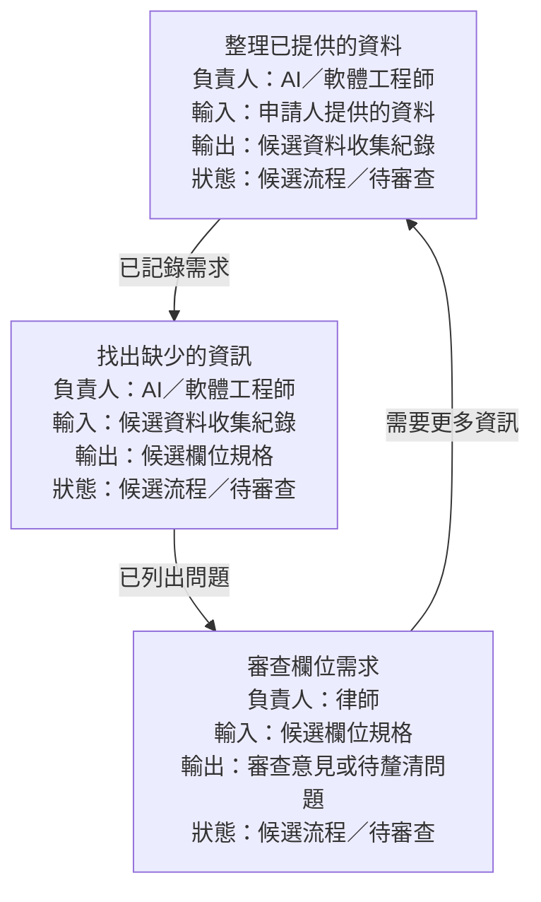

# ElicitMesh

[English](README.md) | [繁體中文](README.zh-TW.md)

**從想法到可供審查的工作流程圖，清楚標示每個節點的輸入與輸出。**

ElicitMesh 協助協作者在實作前釐清流程、每一步的負責人與未知需求。交付成果是流程規格圖；不會產生流程所描述的最終法律文件、工程範圍文件或其他領域產出。

適合用在想法尚未明確、不同角色對流程理解不一致，或需要在實作前確認各步驟之間傳遞哪些資訊的情境。

[Claude Code](#安裝至-claude-code) · [Codex](#安裝至-codex) · [Claude.ai／ZIP](#claudeai-與可攜式技能) · [第一次使用](#開始你的第一個流程)

## 三個獨立階段

| 技能 | 用途 | 主要產出 |
| --- | --- | --- |
| `em-brainstorm` | 釐清目標、參與者、範圍、來源與未知事項 | 簡要需求與待釐清問題 |
| `em-diagram` | 繪製流程、分支與交接，標示各節點的輸入／輸出 | 附註流程圖與 I/O 規格 |
| `em-review` | 找出缺漏、記錄真實專家修正並更新規格 | 修訂流程圖與審查紀錄 |

若不確定從哪裡開始，或需要完整流程引導，可使用 `elicit-mesh`。它仍是三個獨立技能之外的主要入口。

可從任一階段開始，直接使用已有的筆記、流程圖或規格，不需重複腦力激盪。

每個圖中節點都顯示**動作、負責人、輸入、輸出與核准狀態**。詳細型別、必填／未知狀態、預期輸出格式與審查者記錄於對應規格。分支必須標示條件，包括缺少資料時的路徑。

## 你會得到什麼

例如，AI 工程師與律師討論資料收集流程時，可以整理成這樣的圖：



這是規格示例，不代表工作已完成或已取得核准。角色與需求都是待確認的提案。對應的 I/O 表補充各輸入欄位與預期輸出格式，待釐清問題則指出應由誰補足資訊。

## 安裝至 Claude Code

在 Claude Code 內執行：

```text
/plugin marketplace add martin3252/ElicitMesh
/plugin install elicit-mesh@elicitmesh
```

開啟新對話後，要求使用 ElicitMesh，或直接呼叫：

```text
/elicit-mesh:em-brainstorm 我們需要釐清資料收集流程。
/elicit-mesh:em-diagram 將筆記畫成流程圖，標示每個節點的輸入與輸出。
/elicit-mesh:em-review 檢查此圖的欄位缺漏與不清楚的交接。
```

原本的 `/elicit-mesh:elicit-mesh` 入口仍可使用。更新時先執行 `/plugin marketplace update elicitmesh`，再執行 `/plugin update elicit-mesh@elicitmesh`。

## 安裝至 Codex

使用支援外掛的 Codex CLI，在終端機執行：

```sh
codex plugin marketplace add martin3252/ElicitMesh
codex plugin add elicit-mesh@elicitmesh
```

開啟新對話，從技能選單選取、要求使用 ElicitMesh，或輸入 `$elicit-mesh:em-brainstorm`、`$elicit-mesh:em-diagram`、`$elicit-mesh:em-review`。完整流程入口是 `$elicit-mesh:elicit-mesh`。

更新已安裝的 Codex 外掛：

```sh
codex plugin marketplace upgrade elicitmesh
codex plugin add elicit-mesh@elicitmesh
```

更新後請開啟新對話。

請參閱官方 [Codex 技能說明](https://developers.openai.com/codex/skills)與[外掛文件](https://developers.openai.com/codex/plugins/build)。若版本不支援外掛，將技能 ZIP 解壓縮至 `~/.agents/skills/` 或專案的 `.agents/skills/`。獨立安裝時名稱例如 `$em-diagram`。請擇一安裝，避免重複項目。

## Claude.ai 與可攜式技能

下載完整引導流程 [skill.zip](https://github.com/martin3252/ElicitMesh/raw/refs/heads/main/dist/skill.zip)，或安裝個別階段：

- [em-brainstorm.zip](https://github.com/martin3252/ElicitMesh/raw/refs/heads/main/dist/em-brainstorm.zip)
- [em-diagram.zip](https://github.com/martin3252/ElicitMesh/raw/refs/heads/main/dist/em-diagram.zip)
- [em-review.zip](https://github.com/martin3252/ElicitMesh/raw/refs/heads/main/dist/em-review.zip)

在 Claude.ai 的 **Settings → Capabilities → Skills（設定 → 功能 → 技能）** 上傳選定 ZIP 並啟用。功能可用性取決於方案、程式碼執行／檔案建立與工作區設定；請參閱 [Anthropic 最新說明](https://support.claude.com/en/articles/12512180-using-skills-in-claude)。更新時重新上傳新版 ZIP。CLI 安裝檢查不代表已驗證 Claude.ai 上傳。

每個 ZIP 都包含可獨立使用的技能指令、共用參考資料、範例、繪圖工具與驗證工具。其他相容代理也可使用解壓縮後的技能目錄。支援英文及繁體中文，YAML 欄位與穩定 ID 維持英文。

## 開始你的第一個流程

安裝後，可在代理對話中依序使用以下提示，也可以只使用其中一個階段。

### 1. 釐清想法

```text
使用 em-brainstorm。我是與律師合作的軟體工程師。
我們希望在實作前釐清資料收集流程。
請協助確認目標、角色、範圍與需要解決的問題。
```

### 2. 繪製流程

```text
使用 em-diagram。將我們的簡要需求整理成候選流程圖。
請在每個圖中節點標示動作、負責人、輸入及輸出，
將未知欄位和分支條件列為待律師確認。
不要產生申請文件。
```

### 3. 審查與修訂

```text
使用 em-review 審查流程圖與 I/O 規格。
找出缺少的輸入、不明確的輸出格式與模糊的分支條件。
依照能回答問題的人員分組，納入我們提供的修正，
並讓尚未釐清的需求保持待確認狀態。
```

等待專家回饋時，可以先以候選流程圖與問題清單作為本次成果。AI 對流程圖的檢視不代表已取得專業核准。

目前僅保留 [AI／軟體工程師與律師](examples/legal-unfair-dismissal/README.md)的範例。這是候選規格示例，不是權威法律程序，其領域需求尚未經專家驗證。其他領域範例延後至能夠審查時再加入。

## 檔案與檢查

腦力激盪階段只需簡短的 `brief.md`。完整流程圖套件包含：

| 檔案 | 用途 |
| --- | --- |
| `workflow.md` | 每個節點中可見負責人與 I/O 的流程圖 |
| `workflow.yaml` | 節點 ID、負責角色與條件分支 |
| `io-contract.yaml` | 輸入欄位、輸出格式、不確定性與審查者 |
| `role-map.yaml` / `.md` | 角色、責任與核准權限 |
| `sources.md` | 實際審閱的來源與未讀取的連結 |
| `expert-questions.md` | 依優先順序與角色分配的問題 |
| `review-log.yaml` | 待審查狀態或真實修正與版本紀錄 |

不要求領域文件範例或品質規則檔案。指令工作流程不需 Python；結構檢查使用 Python 3.10 以上及 PyYAML：

```sh
python -m pip install -r requirements.txt
python scripts/render_diagram.py examples/legal-unfair-dismissal
python scripts/validate_spec.py examples/legal-unfair-dismissal
python -m unittest discover -s tests -v
```

先編輯 YAML，再重新產生流程圖。驗證可找出缺少的 I/O 規格、無效參照、來源／核准資訊缺漏及與規格不同步的圖。它不驗證領域正確性，也無法確認人類是否真的核准。

## 打包

根目錄 `SKILL.md` 是完整流程入口，`skills/em-*/` 是各階段指令。共用 `references/`、`examples/`、`scripts/` 只維護一份。修改發佈來源後執行 `python scripts/build_skill.py`，將產生的 `dist/skills/` 與 ZIP 一併提交。兩種外掛載入相同的四個獨立技能，測試會檢查套件一致性。

## 界線與致謝

使用授權來源及去識別化資料，區分來源事實、AI 假設與真人核准。不要捏造專業規定、必填欄位、法律結論、測量數據或簽核。獨立 AI 檢視須使用新脈絡，否則應標示為同一脈絡的檢視。專業核准仍由人類決定。

部分靈感來自 Google 的 [Elephant-Goldfish Model](https://github.com/google/elephant-goldfish-model) 獨立審查模式。EGM 為選用，未包含其程式碼或審查提示詞。本專案獨立運作，未與 Google 合作或獲其背書。

Apache License 2.0。**v0.2 原型**：想法 → 含節點 I/O 的流程圖 → 審查與修訂。
