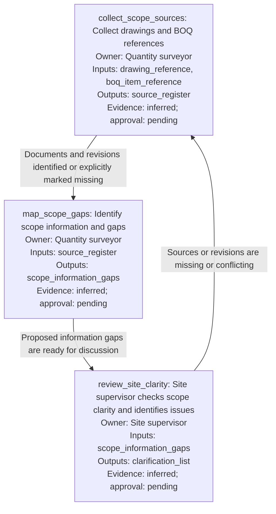

# Candidate workflow specification

Proposed process; domain requirements and human approval remain to be confirmed.

Field types, required/unknown flags, output formats, and reviewers are specified in `io-contract.yaml`.
Outputs named above describe the future process; ElicitMesh has not generated them.
